# 도메인 영향 범위

> `DomainBoundaryArchitectureTest` 가 코드와 `agents/domains.yaml` 로 만드는 파일입니다. 직접 고치지 말고 테스트를 다시 돌리세요.
> 기획 중인 도메인(코드 없이 등록만 한 것)은 yaml 의 dependsOn 으로 계산하고 그래프에서 점선으로 그립니다.

| 도메인 | 설명 | 의존하는 도메인 | 나를 직접 쓰는 도메인 | 영향 범위(간접 포함) |
| --- | --- | --- | --- | --- |
| adultverification | 성인 인증 상태와 이력 | 1 | 10 | 18 |
| appversion | 앱 최소 · 최신 버전 관리 | 1 | 0 | 0 |
| bannedword | 금칙어 관리와 검사 | 0 | 3 | 19 |
| chat | 토픽룸 채팅 메시지 | 3 | 4 | 18 |
| event | 이벤트 · 팝업 · 배너 · 출석 체크 · 당첨자 | 3 | 2 | 18 |
| favorite | 관심 작품 | 2 | 6 | 18 |
| feed | 피드 조회 · 반응 · 댓글 · 신고, 오늘의 피드 | 11 | 6 | 18 |
| genrescore | 사용자 장르 취향 점수 | 3 | 6 | 18 |
| hashtag | 해시태그와 추천 | 4 | 4 | 18 |
| image | 이미지 업로드용 S3 키 관리 | 0 | 3 | 19 |
| library | 내 서재 | 4 | 6 | 18 |
| notification | 알림 저장 · 푸시 발송 | 5 | 5 | 18 |
| onboarding | 온보딩 작품 선택 | 1 | 2 | 18 |
| plus | 게시글 · 리뷰 · 별점 작성 | 11 | 9 | 18 |
| preference | 취향 탐색 | 5 | 3 | 18 |
| profile | 내 · 다른 사람 프로필과 활동 | 11 | 2 | 18 |
| pushdevice | 푸시 기기 토큰 | 0 | 4 | 20 |
| report | 신고 처리와 제재 | 9 | 4 | 18 |
| review | 작품 상세 리뷰 반응 · 신고 | 7 | 3 | 18 |
| search | 검색 · 색인 · 검색 기록 · 인기 검색어 | 4 | 4 | 18 |
| topicroom | 토픽룸 · 참여자 · 랭킹 · 안 읽은 메시지 | 10 | 7 | 18 |
| user | 회원 · 인증 · 약관 · 차단 · 칭호 | 16 | 12 | 18 |
| works | 작품 · 별칭 · 적재 · 병합 | 10 | 16 | 18 |

## adultverification

성인 인증 상태와 이력

- 의존: user
- 나를 직접 쓰는 도메인: event, feed, library, plus, preference, profile, search, topicroom, user, works
- 바꾸면 영향 가는 도메인: chat, event, favorite, feed, genrescore, hashtag, library, notification, onboarding, plus, preference, profile, report, review, search, topicroom, user, works

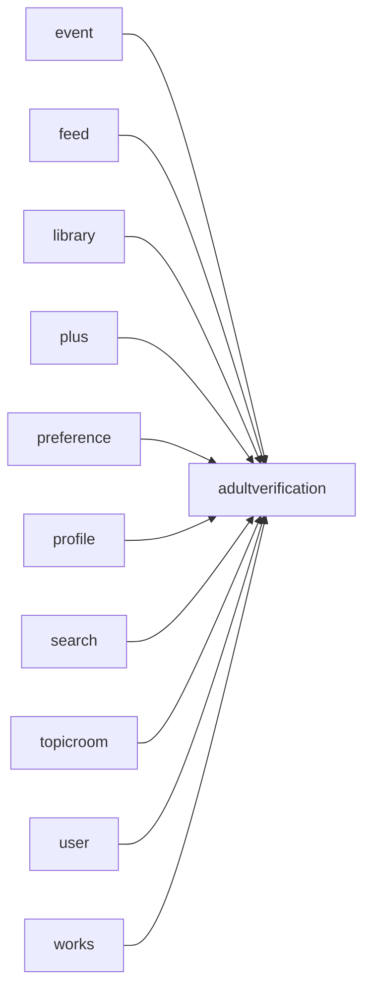

## appversion

앱 최소 · 최신 버전 관리

- 의존: pushdevice
- 나를 직접 쓰는 도메인: 없음
- 바꾸면 영향 가는 도메인: 없음

## bannedword

금칙어 관리와 검사

- 의존: 없음
- 나를 직접 쓰는 도메인: profile, topicroom, user
- 바꾸면 영향 가는 도메인: adultverification, chat, event, favorite, feed, genrescore, hashtag, library, notification, onboarding, plus, preference, profile, report, review, search, topicroom, user, works

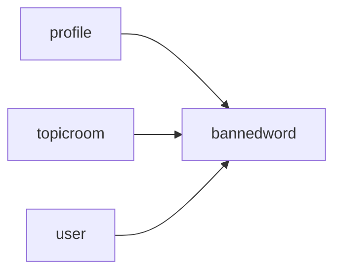

## chat

토픽룸 채팅 메시지

- 의존: topicroom, user, works
- 나를 직접 쓰는 도메인: notification, report, topicroom, user
- 바꾸면 영향 가는 도메인: adultverification, event, favorite, feed, genrescore, hashtag, library, notification, onboarding, plus, preference, profile, report, review, search, topicroom, user, works

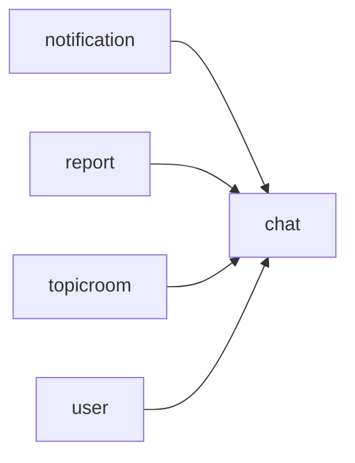

## event

이벤트 · 팝업 · 배너 · 출석 체크 · 당첨자

- 의존: adultverification, user, works
- 나를 직접 쓰는 도메인: notification, works
- 바꾸면 영향 가는 도메인: adultverification, chat, favorite, feed, genrescore, hashtag, library, notification, onboarding, plus, preference, profile, report, review, search, topicroom, user, works

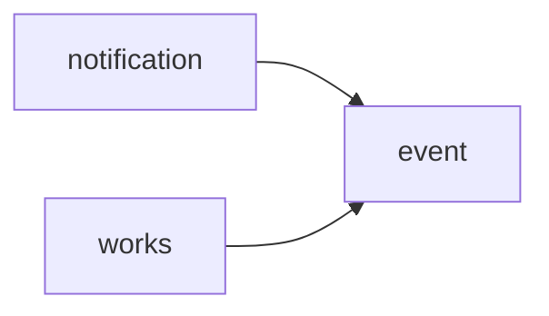

## favorite

관심 작품

- 의존: genrescore, works
- 나를 직접 쓰는 도메인: feed, hashtag, preference, profile, user, works
- 바꾸면 영향 가는 도메인: adultverification, chat, event, feed, genrescore, hashtag, library, notification, onboarding, plus, preference, profile, report, review, search, topicroom, user, works

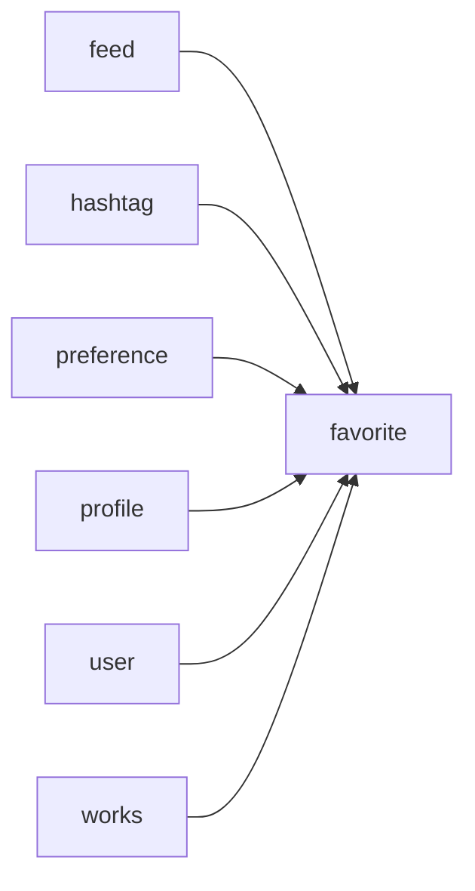

## feed

피드 조회 · 반응 · 댓글 · 신고, 오늘의 피드

- 의존: adultverification, favorite, library, notification, plus, profile, report, search, topicroom, user, works
- 나를 직접 쓰는 도메인: library, plus, profile, report, search, user
- 바꾸면 영향 가는 도메인: adultverification, chat, event, favorite, genrescore, hashtag, library, notification, onboarding, plus, preference, profile, report, review, search, topicroom, user, works

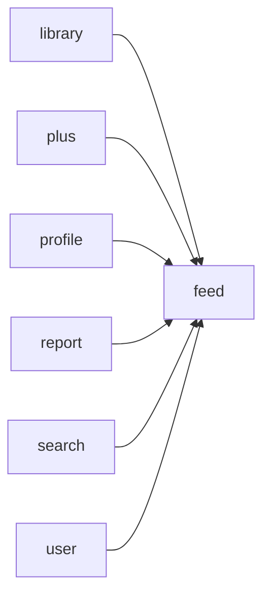

## genrescore

사용자 장르 취향 점수

- 의존: preference, user, works
- 나를 직접 쓰는 도메인: favorite, plus, profile, topicroom, user, works
- 바꾸면 영향 가는 도메인: adultverification, chat, event, favorite, feed, hashtag, library, notification, onboarding, plus, preference, profile, report, review, search, topicroom, user, works

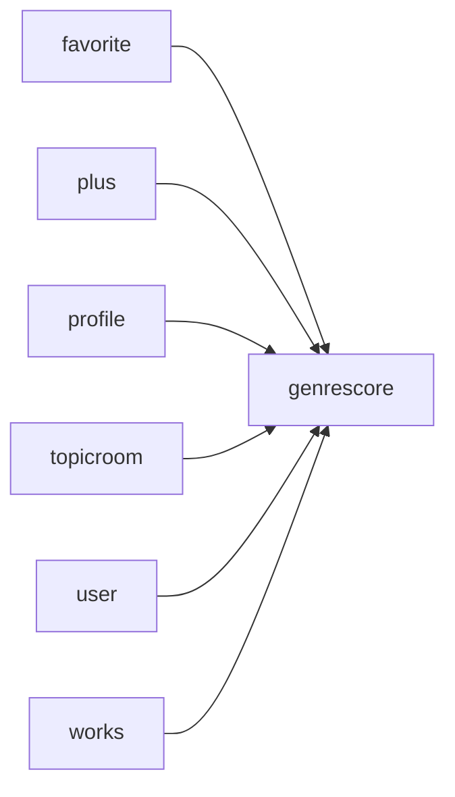

## hashtag

해시태그와 추천

- 의존: favorite, preference, user, works
- 나를 직접 쓰는 도메인: plus, preference, profile, works
- 바꾸면 영향 가는 도메인: adultverification, chat, event, favorite, feed, genrescore, library, notification, onboarding, plus, preference, profile, report, review, search, topicroom, user, works

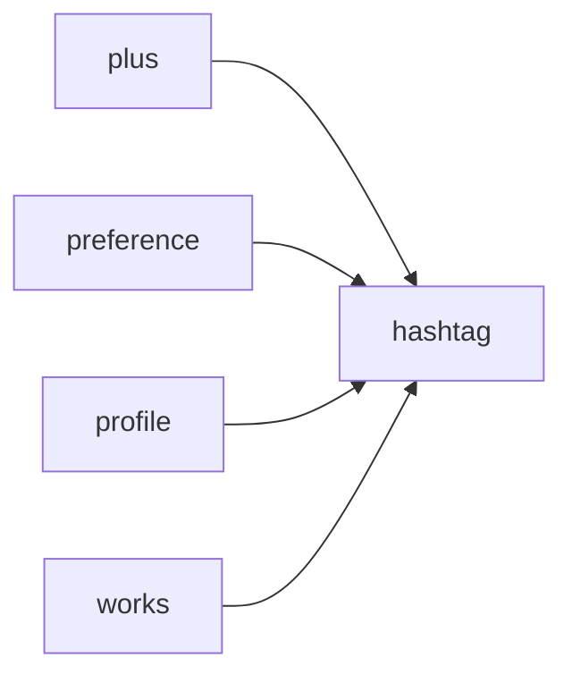

## image

이미지 업로드용 S3 키 관리

- 의존: 없음
- 나를 직접 쓰는 도메인: plus, profile, user
- 바꾸면 영향 가는 도메인: adultverification, chat, event, favorite, feed, genrescore, hashtag, library, notification, onboarding, plus, preference, profile, report, review, search, topicroom, user, works

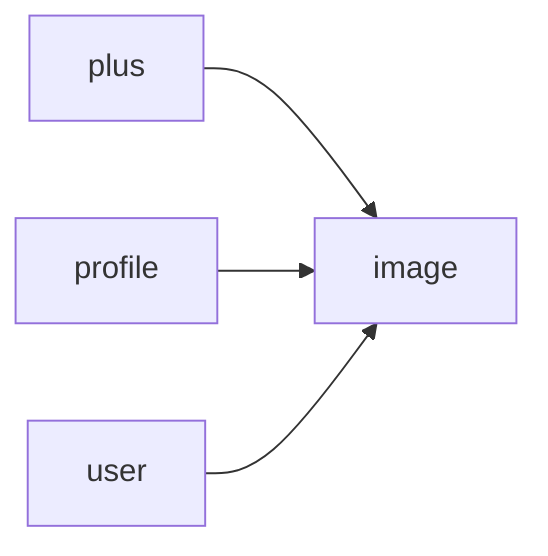

## library

내 서재

- 의존: adultverification, feed, plus, works
- 나를 직접 쓰는 도메인: feed, plus, profile, report, review, user
- 바꾸면 영향 가는 도메인: adultverification, chat, event, favorite, feed, genrescore, hashtag, notification, onboarding, plus, preference, profile, report, review, search, topicroom, user, works

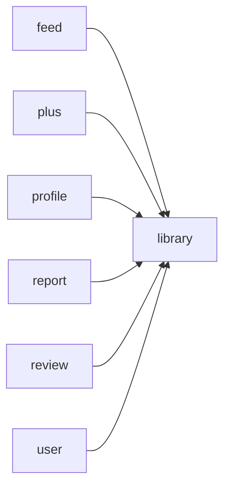

## notification

알림 저장 · 푸시 발송

- 의존: chat, event, pushdevice, topicroom, user
- 나를 직접 쓰는 도메인: feed, report, review, topicroom, user
- 바꾸면 영향 가는 도메인: adultverification, chat, event, favorite, feed, genrescore, hashtag, library, onboarding, plus, preference, profile, report, review, search, topicroom, user, works

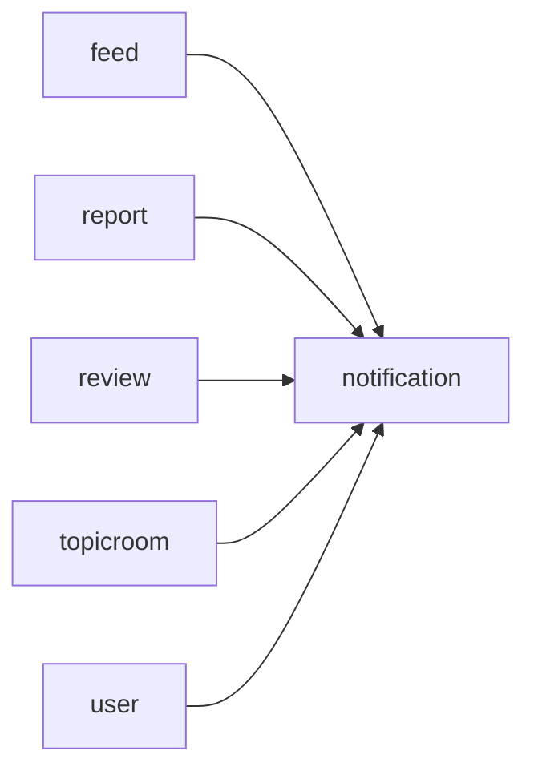

## onboarding

온보딩 작품 선택

- 의존: works
- 나를 직접 쓰는 도메인: user, works
- 바꾸면 영향 가는 도메인: adultverification, chat, event, favorite, feed, genrescore, hashtag, library, notification, plus, preference, profile, report, review, search, topicroom, user, works

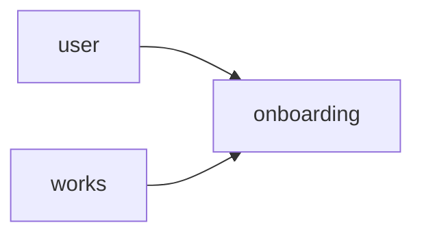

## plus

게시글 · 리뷰 · 별점 작성

- 의존: adultverification, feed, genrescore, hashtag, image, library, profile, review, search, user, works
- 나를 직접 쓰는 도메인: feed, library, preference, profile, report, review, search, user, works
- 바꾸면 영향 가는 도메인: adultverification, chat, event, favorite, feed, genrescore, hashtag, library, notification, onboarding, preference, profile, report, review, search, topicroom, user, works

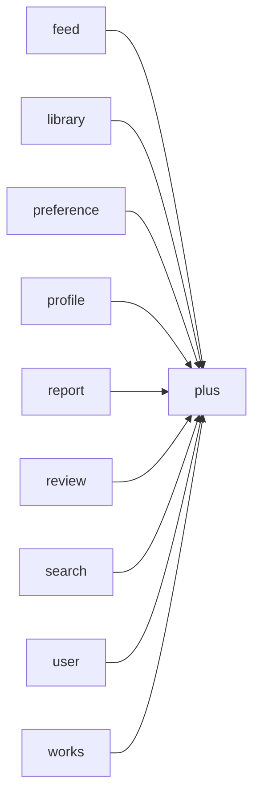

## preference

취향 탐색

- 의존: adultverification, favorite, hashtag, plus, works
- 나를 직접 쓰는 도메인: genrescore, hashtag, works
- 바꾸면 영향 가는 도메인: adultverification, chat, event, favorite, feed, genrescore, hashtag, library, notification, onboarding, plus, profile, report, review, search, topicroom, user, works

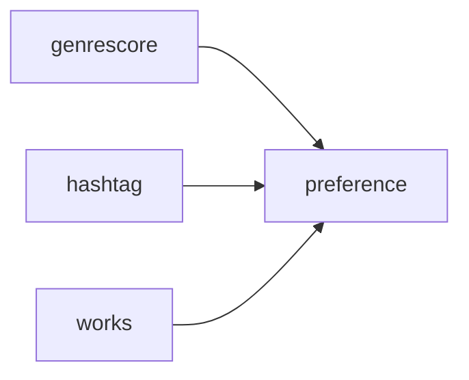

## profile

내 · 다른 사람 프로필과 활동

- 의존: adultverification, bannedword, favorite, feed, genrescore, hashtag, image, library, plus, user, works
- 나를 직접 쓰는 도메인: feed, plus
- 바꾸면 영향 가는 도메인: adultverification, chat, event, favorite, feed, genrescore, hashtag, library, notification, onboarding, plus, preference, report, review, search, topicroom, user, works

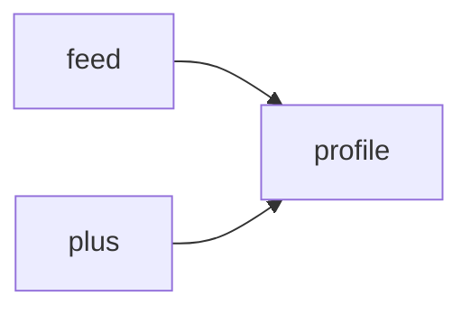

## pushdevice

푸시 기기 토큰

- 의존: 없음
- 나를 직접 쓰는 도메인: appversion, notification, topicroom, user
- 바꾸면 영향 가는 도메인: adultverification, appversion, chat, event, favorite, feed, genrescore, hashtag, library, notification, onboarding, plus, preference, profile, report, review, search, topicroom, user, works

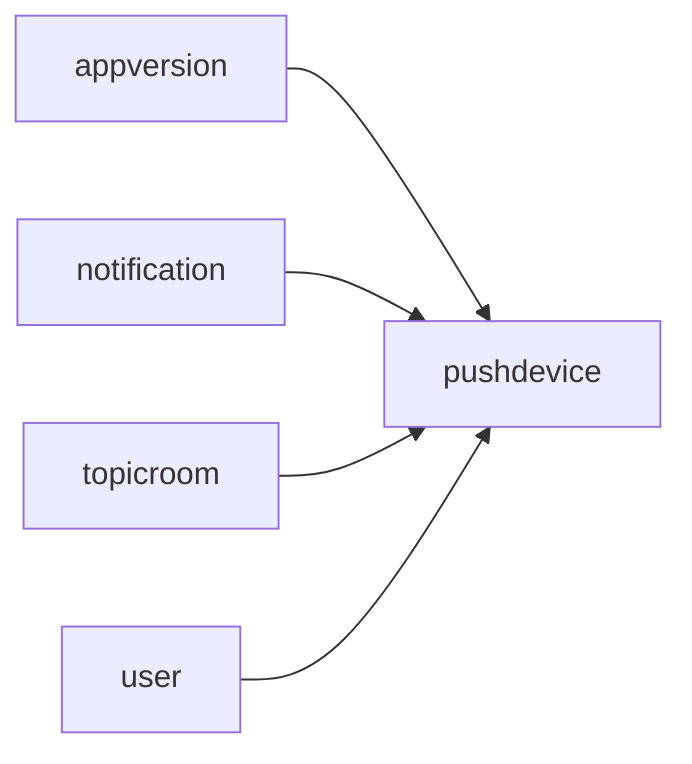

## report

신고 처리와 제재

- 의존: chat, feed, library, notification, plus, review, topicroom, user, works
- 나를 직접 쓰는 도메인: feed, review, topicroom, user
- 바꾸면 영향 가는 도메인: adultverification, chat, event, favorite, feed, genrescore, hashtag, library, notification, onboarding, plus, preference, profile, review, search, topicroom, user, works

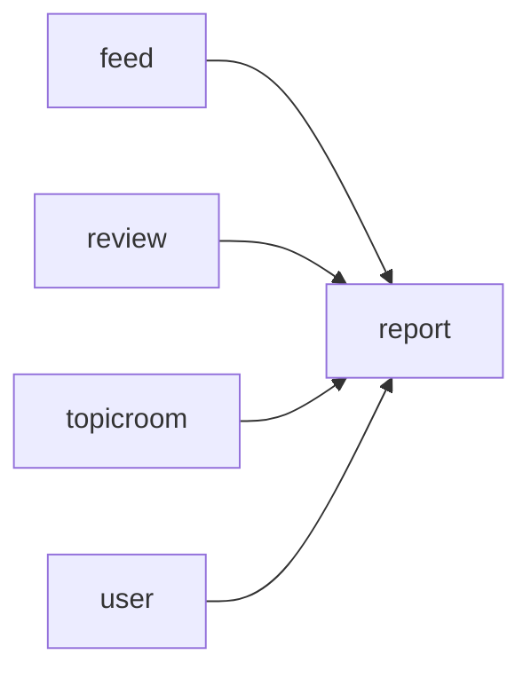

## review

작품 상세 리뷰 반응 · 신고

- 의존: library, notification, plus, report, topicroom, user, works
- 나를 직접 쓰는 도메인: plus, report, user
- 바꾸면 영향 가는 도메인: adultverification, chat, event, favorite, feed, genrescore, hashtag, library, notification, onboarding, plus, preference, profile, report, search, topicroom, user, works

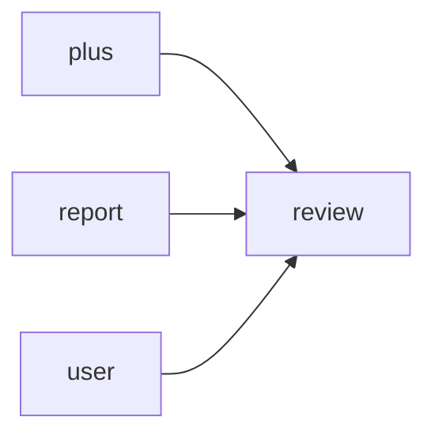

## search

검색 · 색인 · 검색 기록 · 인기 검색어

- 의존: adultverification, feed, plus, works
- 나를 직접 쓰는 도메인: feed, plus, topicroom, works
- 바꾸면 영향 가는 도메인: adultverification, chat, event, favorite, feed, genrescore, hashtag, library, notification, onboarding, plus, preference, profile, report, review, topicroom, user, works

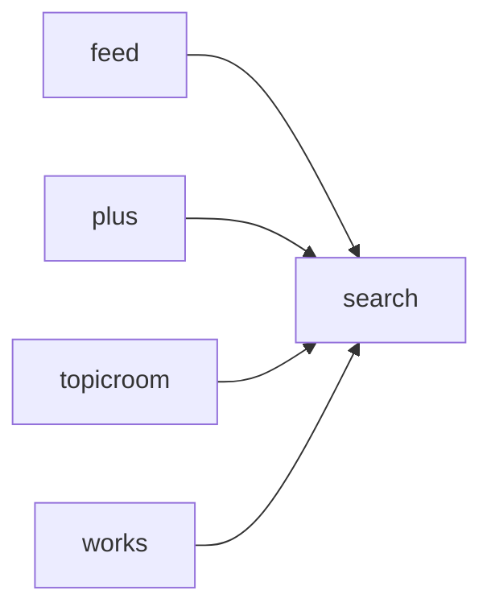

## topicroom

토픽룸 · 참여자 · 랭킹 · 안 읽은 메시지

- 의존: adultverification, bannedword, chat, genrescore, notification, pushdevice, report, search, user, works
- 나를 직접 쓰는 도메인: chat, feed, notification, report, review, user, works
- 바꾸면 영향 가는 도메인: adultverification, chat, event, favorite, feed, genrescore, hashtag, library, notification, onboarding, plus, preference, profile, report, review, search, user, works

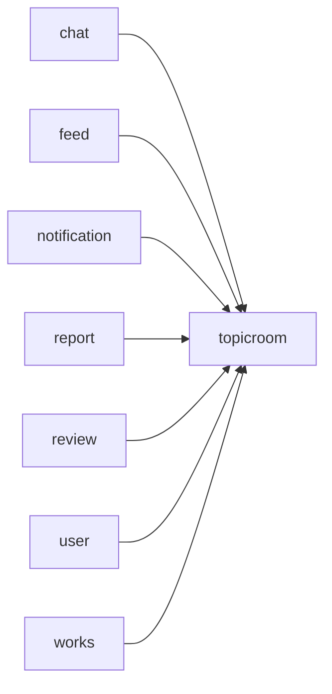

## user

회원 · 인증 · 약관 · 차단 · 칭호

- 의존: adultverification, bannedword, chat, favorite, feed, genrescore, image, library, notification, onboarding, plus, pushdevice, report, review, topicroom, works
- 나를 직접 쓰는 도메인: adultverification, chat, event, feed, genrescore, hashtag, notification, plus, profile, report, review, topicroom
- 바꾸면 영향 가는 도메인: adultverification, chat, event, favorite, feed, genrescore, hashtag, library, notification, onboarding, plus, preference, profile, report, review, search, topicroom, works

```mermaid
graph LR
  adultverification --> user
  chat --> user
  event --> user
  feed --> user
  genrescore --> user
  hashtag --> user
  notification --> user
  plus --> user
  profile --> user
  report --> user
  review --> user
  topicroom --> user
```

## works

작품 · 별칭 · 적재 · 병합

- 의존: adultverification, event, favorite, genrescore, hashtag, onboarding, plus, preference, search, topicroom
- 나를 직접 쓰는 도메인: chat, event, favorite, feed, genrescore, hashtag, library, onboarding, plus, preference, profile, report, review, search, topicroom, user
- 바꾸면 영향 가는 도메인: adultverification, chat, event, favorite, feed, genrescore, hashtag, library, notification, onboarding, plus, preference, profile, report, review, search, topicroom, user

```mermaid
graph LR
  chat --> works
  event --> works
  favorite --> works
  feed --> works
  genrescore --> works
  hashtag --> works
  library --> works
  onboarding --> works
  plus --> works
  preference --> works
  profile --> works
  report --> works
  review --> works
  search --> works
  topicroom --> works
  user --> works
```
